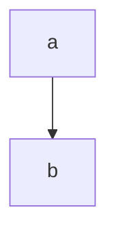

形式科学就在逻辑空间之中。其研究对象不依赖外部经验，而是直接抽象自逻辑本身。形式科学的目标就是穷尽逻辑空间的结构。在形式科学中，只要一个东西不矛盾，它就在这个逻辑空间中占有一席之地。

非形式科学在逻辑空间中筛选，与形式科学一样，同样依赖严密的逻辑结构，但目的不是为了穷尽可能性，而是为了找出与现实世界对应的区域，也就是说每个非形式科学都对应非形式逻辑空间，且这个非形式逻辑空间属于整体的逻辑空间（也就是形式逻辑空间）

形式逻辑空间中的东西要变成现实，必须要依靠非形式逻辑空间中的被现实验证过的逻辑？或者是关于物的逻辑空间？但是物本身就存在，是现实的，不是逻辑的，那么就是使用物的工程经验。

